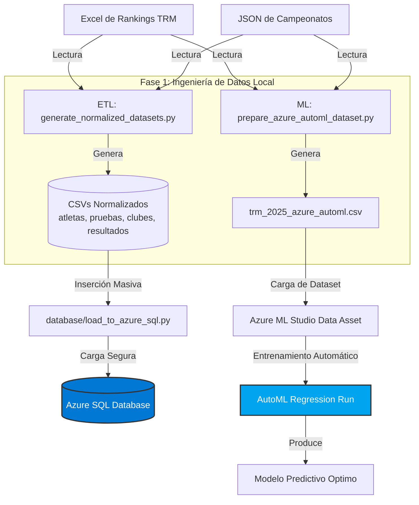

# 🏆 Proyecto TFM: Análisis Predictivo y Almacenamiento Relacional (FETRI 2025)

¡Bienvenido al repositorio oficial del TFM de Triatlón! Este proyecto implementa una solución integral de ingeniería de datos y ciencia de datos orientada al **Triatlón Masculino 2025 (TRM)**. 

La arquitectura combina un **pipeline local de procesamiento y limpieza (ETL)**, un **almacén de datos analítico en Azure SQL Database**, y un **modelo predictivo de alto rendimiento entrenado en la nube con Azure Machine Learning AutoML**.

---

## 🏗️ Arquitectura de la Solución

El flujo de información se divide en dos fases principales (Local y Azure Cloud), garantizando modularidad, seguridad y alto rendimiento:



---

## 📂 Mapa del Directorio y Componentes

El espacio de trabajo ha sido optimizado y reestructurado bajo la regla de **"solo lo esencial"**, agrupando el código según su función lógica:

```text
/ (Raíz del proyecto)
│   .gitignore               # Filtros de Git para excluir datos sensibles y temporales
│   README.md                # Esta guía de uso y documentación de arquitectura
│
├───data                     # Contenedor de datos del proyecto (ignorado en Git por RGPD)
│   ├───processed            # Datasets limpios generados en CSV listos para BD y AutoML
│   │       clubes_geo_2025.csv
│   │       deportistas_2025.csv
│   │       pruebas_2025.csv
│   │       resultados_2025.csv
│   │       trm_2025_azure_automl.csv
│   │
│   └───raw                  # Datos de entrada originales e inmutables (Excel y JSONs)
│       │   calendar_cities_db.json
│       │   club_coords_cache.json
│       │
│       ├───Campeonatos      # Calendarios oficiales de campeonatos FETRI
│       │       championships%3A2025.json (y otros años)
│       │
│       └───triatlon_masculino # Rankings masculinos originales federativos
│               trm_2025_original.xlsx
│               trm_2025_limpio.xlsx
│
├───database                 # Base de Datos Relacional
│       azure_sql_schema.sql # Esquema DDL físico y poblado inicial para Azure SQL (T-SQL)
│       load_to_azure_sql.py # Cargador de CSVs directo y de alto rendimiento hacia Azure SQL
│
├───docs                     # Documentación de negocio y académica
│       CONTEXTO_PROYECTO.md # Descripción, objetivos y decisiones de diseño del TFM
│       lista_todos_los_excel.md # Detalles, campos e interpretación de los rankings
│
└───ml_pipeline              # Ciencia de Datos y Machine Learning
        generate_normalized_datasets.py # Script ETL para normalización y creación del modelo estrella (CSV)
        prepare_azure_automl_dataset.py # Script de preparación del dataset enriquecido para Azure AutoML
        importacion_y_limpieza.ipynb    # Notebook de exploración de datos y prototipado rápido
```

---

## 🚀 Guía de Ejecución Paso a Paso

Sigue este orden cronológico para reproducir los resultados o actualizar la base de datos y el modelo predictivo:

### 📋 Requisitos Previos
Asegúrate de tener instaladas las bibliotecas de Python necesarias para procesamiento de datos, conexión SQL y Excel:
```bash
pip install pandas openpyxl sqlalchemy pyodbc
```

### Paso 1: Ejecutar la Limpieza y Normalización ETL
Este script lee las fuentes originales de `/data/raw` y genera las 4 tablas normalizadas del esquema de estrella en `/data/processed`:
```bash
python ml_pipeline/generate_normalized_datasets.py
```

### Paso 2: Generar el Dataset para Machine Learning (Azure AutoML)
Este script procesa las participaciones en orden cronológico estricto para calcular estadísticas acumuladas (*rolling features*) sin fuga de datos, aplica hashing SHA-256 a los DNIs para cumplir la ley de protección de datos (**RGPD**) y estima las distancias de viaje de los clubes por Haversine. Guarda el archivo resultante en `/data/processed/trm_2025_azure_automl.csv`:
```bash
python ml_pipeline/prepare_azure_automl_dataset.py
```

### Paso 3: Crear el Esquema en Azure SQL Database
1. Crea tu recurso de **Azure SQL Database** en el portal de Azure (`portal.azure.com`).
2. Configura el Firewall de tu servidor en Azure para **permitir el acceso desde tu dirección IP pública**.
3. Conéctate a la base de datos usando Azure Data Studio, DBeaver o el Query Editor de Azure y ejecuta el archivo:
   👉 `database/azure_sql_schema.sql`

### Paso 4: Cargar los CSVs a la Nube
1. Abre el script `database/load_to_azure_sql.py`.
2. Completa tus credenciales de Azure SQL en las variables del bloque de configuración (líneas 14 a 17):
   * `AZURE_SERVER`, `AZURE_DB`, `AZURE_USER`, `AZURE_PASSWORD`.
3. Ejecuta el script para realizar la carga masiva optimizada (`fast_executemany`):
   ```bash
   python database/load_to_azure_sql.py
   ```

### Paso 5: Entrenar el Modelo en Azure Machine Learning Studio
1. Entra a **Azure ML Studio** (`ml.azure.com`).
2. Ve a **Data** $\rightarrow$ **Create Data Asset** $\rightarrow$ *From local files* y sube el archivo `/data/processed/trm_2025_azure_automl.csv`.
3. Ve a **Automated ML** $\rightarrow$ **New Automated ML Job**:
   * Selecciona el Data Asset creado.
   * Elige la tarea de **Regresión** (Regression).
   * Define la columna objetivo como **`PUNTOS_TARGET`**.
   * En la configuración de características, **excluye** `ATLETA_ID_HASH` y `PUESTO_TARGET` para que no afecten al entrenamiento del modelo predictivo (y mantén el resto de las variables como variables predictoras).
4. ¡Lanza el experimento y deja que Azure AutoML encuentre automáticamente el mejor algoritmo!

---

## 🛡️ Aspectos Destacados de Diseño e Ingeniería

* **🛡️ Cumplimiento estricto del RGPD:** Los DNIs reales se cifran utilizando hash SHA-256 truncado a 16 caracteres (`ATLETA_ID_HASH`), lo que permite que el modelo identifique la recurrencia de un atleta sin exponer sus datos personales en la nube pública.
* **⚡ Alto Rendimiento Relacional:** El esquema relacional en Azure SQL cuenta con claves primarias y foráneas (`PRIMARY KEY`, `FOREIGN KEY`), asegurando consistencia referencial estricta. El cargador de Python usa `fast_executemany=True` para acelerar las inserciones hasta 100 veces sobre la red.
* **📈 Cero Fuga de Datos (Data Leakage):** Las variables de Machine Learning (*rolling statistics*) de cada atleta se calculan estrictamente de forma cronológica sobre las carreras anteriores a la fecha del evento evaluado, simulando un entorno de predicción real.
