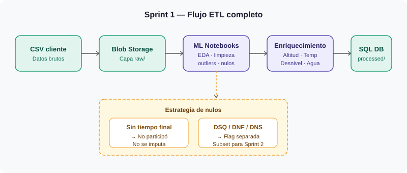
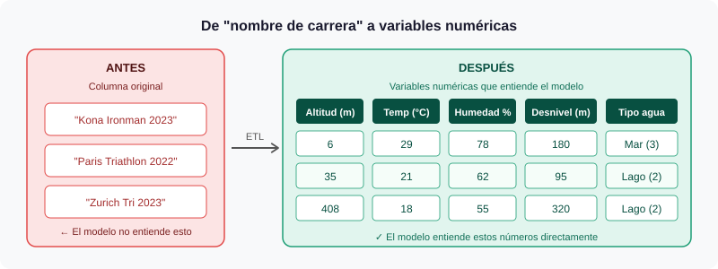

# Sprint 1 — Ingesta de Datos, ETL y Análisis Exploratorio

> **Fechas:** 07/04/2026 → 04/05/2026 · 4 semanas  
> **Equipo:** Mario García · Alejandro Benítez  
> **Proyecto:** Predictivo Triatlón Élite Masculino — Conersys

---

## ¿Qué hacemos en este sprint?

Antes de tocar cualquier modelo, necesitamos datos limpios y bien estructurados. El **70% del esfuerzo** de este sprint es ETL puro. Sin buenos datos no hay buen modelo.

---

## Dónde viven los datos

| Recurso | Para qué |
|---|---|
| **Azure Blob Storage** `raw/` | El CSV original sin tocar (nunca se modifica) |
| **Azure Blob Storage** `processed/` | Datos limpios y enriquecidos listos para ML |
| **Azure SQL Database** | Tablas de atletas, pruebas y resultados para la app |

---

## El problema con los datos del cliente

Los datos llegan con **muchas celdas vacías** porque no todos los atletas participan en todas las carreras. Esto es normal en triatlón de élite. Aquí está la estrategia:

| Caso | Qué hacemos |
|---|---|
| Atleta sin tiempo en una prueba | Se interpreta como "no participó" — **no se imputa con media** |
| Tiempo en percentil <1% o >99% | Se revisa a mano — si es error se elimina, si es real se mantiene con flag |
| Registro DSQ / DNF / DNS | Se etiqueta como clase separada para usarla en Sprint 2 |

---

## La transformación más importante: nombres de carrera → números

El nombre de cada prueba no le dice nada al modelo. Lo sustituimos por variables numéricas que sí tienen sentido predictivo:

**Fuentes de datos para el enriquecimiento:**
- **Open-Meteo API** → temperatura e humedad histórica del día de la prueba
- **World Triathlon** (datos públicos) → altitud, desnivel acumulado, tipo de agua

---

## Tareas del sprint

### HU-S1.1 — Carga inicial de datos brutos
El CSV del cliente sube a Azure Blob Storage en la carpeta `raw/` sin ninguna modificación. Se registra el hash MD5 para auditoría.

**Listo cuando:** fichero en `raw/`, fecha y hash registrados, proceso reproducible con un script.

---

### HU-S1.2 — Análisis Exploratorio (EDA)
Antes de limpiar nada, entendemos qué tenemos: distribuciones, correlaciones, atletas con muy pocos datos, posibles errores.

**Listo cuando:** notebook de EDA con distribución del tiempo final, % de nulos por columna, y lista de atletas con menos del 30% de carreras completadas.

---

### HU-S1.3 — Limpieza de nulos y outliers
Aplicamos la estrategia de la tabla de arriba. El resultado va a la carpeta `processed/`.

**Listo cuando:** informe de calidad (nº filas eliminadas, nulos tratados, outliers detectados).

---

### HU-S1.4 — Enriquecimiento con variables de carrera
Sustituimos el nombre de cada prueba por las variables numéricas (altitud, temperatura, humedad, desnivel, tipo de agua).

**Listo cuando:** tabla de referencia de pruebas completada y versionada en el repositorio.

---

### HU-S1.5 — Identificación de descalificaciones
Si el dataset incluye resultados DSQ/DNF/DNS, los etiquetamos. Si no, se lo comunicamos al Product Owner en los primeros 3 días.

**Listo cuando:** variable `descalificado` creada (o decisión documentada de por qué no se puede).

---

## Riesgos

| Riesgo | Impacto | Probabilidad | Plan |
|---|---|---|---|
| No hay columna de resultado (solo tiempos) | Alto | Media | Escalar al PO en los primeros 3 días |
| Fuentes meteorológicas con fechas erróneas | Medio | Media | Imputar con media histórica de la ciudad si falta el dato |
| Muy pocos casos DSQ (<30) | Alto | Alta | Se documenta y se aborda en Sprint 2 con detección de anomalías |

---

## ✅ Definition of Done

- [ ] Dataset procesado en Azure Blob Storage capa `processed/`
- [ ] Notebook de EDA revisado por el equipo
- [ ] Tabla de enriquecimiento de pruebas completada y versionada
- [ ] Informe de calidad de datos entregado al Product Owner
- [ ] Decisión sobre DSQ documentada y acordada
