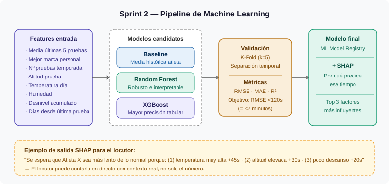

# Sprint 2 — Motor Predictivo ML

> **Fechas:** 25/05/2026 → 05/06/2026 · 2 semanas  
> **Equipo:** Mario García · Alejandro Benítez  
> **Proyecto:** Predictivo Triatlón Élite Masculino — Conersys

---

## ¿Qué hacemos en este sprint?

Con los datos limpios del Sprint 1, entrenamos el modelo que predice el **tiempo final** de cada atleta en una prueba. Al terminar, el modelo tiene que ser lo suficientemente rápido y fiable para ser consumido por una API.

---

## ¿Qué predice el modelo?

Dado un atleta y una prueba concreta, el modelo devuelve:

- El **tiempo final esperado** (en segundos y en formato legible)
- Un **intervalo de confianza** (ej: entre 1h43 y 1h47 con 90% de certeza)
- Los **3 factores más influyentes** en esa predicción (gracias a SHAP)

Esto permite al locutor saber, antes de la salida, qué tiempo es esperable y **por qué**.

---

## Variables de entrada del modelo (features)

| Variable | Qué mide |
|---|---|
| `media_tiempo_ultimas_5_pruebas` | Rendimiento reciente del atleta |
| `mejor_marca_personal` | Techo histórico de rendimiento |
| `nº_pruebas_completadas_temporada` | Volumen competitivo de la temporada |
| `altitud_prueba` | Efecto fisiológico del entorno |
| `temperatura_dia` | Fatiga térmica |
| `humedad_dia` | Confort y rendimiento |
| `desnivel_acumulado` | Dificultad del circuito |
| `tipo_agua` | Piscina (1) · Lago (2) · Mar abierto (3) |
| `dias_desde_ultima_prueba` | Estado de recuperación aproximado |

> ⚠️ Ninguna feature contiene información del futuro — sin data leakage.

---

## ¿Qué modelo elegimos?

Entrenamos dos candidatos y elegimos el mejor por RMSE en validación cruzada:

| Modelo | Ventaja | Cuándo lo elegimos |
|---|---|---|
| **Random Forest** | Robusto, interpretable, no requiere escalar variables | Si la diferencia con XGBoost es <3% |
| **XGBoost** | Mejor rendimiento en datos tabulares deportivos | Si mejora el RMSE en más de un 3% |

La validación usa **k-fold temporal**: las pruebas más recientes son siempre el test, las antiguas el train. Nunca al revés.

**Objetivo de error: RMSE < 120 segundos** (= menos de 2 minutos de error medio). En triatlón de élite, 2 minutos de margen es aceptable para predicción pre-carrera.

---

## SHAP: explicar cada predicción

SHAP permite al sistema decir algo como:

> *"Se espera que este atleta sea más lento de lo normal porque: la temperatura está 8°C por encima de su media habitual (+45s), la altitud es elevada (+30s) y lleva solo 3 días de descanso (+20s)"*

Esto le da al locutor contexto real para contar una historia más interesante que solo leer un número.

---

## Clasificador de descalificación (condicional)

> Solo se desarrolla si el Sprint 1 identificó **≥ 30 casos DSQ etiquetados**.

Si hay datos suficientes, entrenamos un clasificador que devuelve la **probabilidad de descalificación** (0 a 1) para cada atleta. Si no hay suficientes datos, usamos **Isolation Forest** (detección de anomalías no supervisada).

| Situación | Qué hacemos |
|---|---|
| ≥ 30 casos DSQ | Clasificador binario (Random Forest Classifier) |
| < 30 casos DSQ | Detección de anomalías (Isolation Forest) |
| Sin columna de resultado | Documentado como mejora futura |

---

## Tareas del sprint

### HU-S2.1 — Feature engineering
Construir y documentar todas las variables de entrada. Ninguna debe contener información futura.

**Listo cuando:** pipeline de transformación reproducible y versionado en Azure ML.

---

### HU-S2.2 — Entrenamiento y selección de modelo
Entrenar Random Forest y XGBoost, comparar por RMSE, elegir uno.

**Listo cuando:** modelo registrado en Azure ML Model Registry con métricas documentadas.

---

### HU-S2.3 — Módulo SHAP
Para cada predicción, el sistema devuelve los 3 factores más influyentes y su efecto en segundos.

**Listo cuando:** SHAP funcional y probado con ejemplos reales.

---

### HU-S2.4 — Clasificador DSQ
Condicional según los datos disponibles (ver tabla arriba).

**Listo cuando:** modelo registrado o decisión documentada con justificación.

---

## Riesgos

| Riesgo | Impacto | Probabilidad | Plan |
|---|---|---|---|
| Pocos datos por atleta → modelo genérico | Alto | Alta | Usar `atleta_id` como feature + media histórica como proxy de nivel |
| RMSE > 2 minutos | Medio | Media | Consensuar umbral con PO — en triatlón puede ser aceptable |
| DSQ insuficientes para clasificador | Alto | Alta | Isolation Forest como alternativa |

---

## ✅ Definition of Done

- [ ] Modelo registrado en Azure ML Model Registry con métricas documentadas
- [ ] RMSE en test documentado (objetivo <120s)
- [ ] Pipeline de entrenamiento reproducible con un solo comando
- [ ] Módulo SHAP funcional y probado
- [ ] Decisión sobre DSQ documentada y aprobada por el PO
