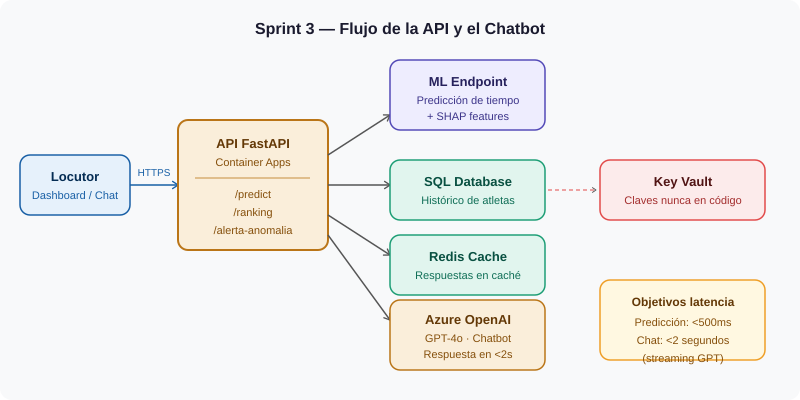

# Sprint 3 — API REST, Despliegue en Azure y Chatbot

> **Fechas:** 08/06/2026 → 19/06/2026 · 2 semanas  
> **Equipo:** Mario García · Alejandro Benítez  
> **Proyecto:** Predictivo Triatlón Élite Masculino — Conersys

---

## ¿Qué hacemos en este sprint?

Tomamos el modelo del Sprint 2 y lo convertimos en algo que el dashboard puede usar. Construimos la API que une todo y conectamos el chatbot del locutor.



---

## Cómo se comunican los componentes

```
[ML Online Endpoint]  →  [API FastAPI · Container Apps]  →  [Frontend Blazor]
                                      ↑
                          [Azure OpenAI · Chatbot GPT-4o]
                                      ↑
                              [Azure Key Vault]
                           (todas las claves aquí,
                            nunca en el código)
```

---

## Los endpoints de la API

### `POST /api/v1/predict` — Predicción individual

**Qué recibe:**
```json
{
  "atleta_id": "AT-0042",
  "prueba_id": "PR-2024-KONA"
}
```

**Qué devuelve:**
```json
{
  "tiempo_predicho_formato": "1h 44m 32s",
  "intervalo_confianza_90": ["1h 43m 00s", "1h 46m 10s"],
  "top_features": [
    { "factor": "temperatura_dia",  "efecto": "+45s" },
    { "factor": "media_ultimas_5",  "efecto": "-120s" },
    { "factor": "altitud_prueba",   "efecto": "+30s" }
  ],
  "riesgo_dsq": 0.08
}
```

**Objetivo de latencia: <500ms**

---

### `GET /api/v1/ranking/{prueba_id}` — Clasificación completa

Devuelve el ranking predictivo de todos los atletas inscritos. Paginado: 10 por defecto, el resto con `?page=2`.

**Objetivo de latencia: <1s para 100 atletas**

---

### `POST /api/v1/alerta-anomalia` — Detección en directo

Recibe el tiempo parcial real de un atleta y compara con la predicción. Si la desviación supera el **10%**, devuelve una alerta.

```json
{
  "atleta_id": "AT-0042",
  "tiempo_real_parcial_segundos": 3200,
  "desviacion_pct": 14.2,
  "severidad": "ALTA"
}
```

---

## El chatbot del locutor

Usa **Azure OpenAI (GPT-4o)** con el contexto de la carrera inyectado en el sistema de prompts.

| Regla del chatbot | Por qué |
|---|---|
| Solo responde con datos del contexto de carrera | Evita que invente resultados |
| Si no sabe algo → "Dato no disponible" | Nunca especula |
| Temperatura = 0 en la llamada a OpenAI | Respuestas deterministas, sin aleatoriedad |
| Cada respuesta incluye un botón de navegación | El locutor puede ver más sin buscar |

**Objetivo de latencia: <2 segundos** (usando streaming de GPT para que el primer token aparezca antes)

---

## Estrategia de mocks (muy importante)

Desde el **día 1 del sprint**, la API publica respuestas simuladas con el mismo esquema JSON que las reales. Así el equipo de frontend puede avanzar en el Sprint 4 sin esperar al modelo en producción.

| Endpoint | Disponible desde |
|---|---|
| Mock de `/predict` | Día 1 del sprint |
| Mock de `/ranking` | Día 1 del sprint |
| Versión real conectada al modelo | Semana 2 |

---

## Seguridad

- Autenticación por `X-API-Key` en cabecera HTTP — sin clave, devuelve 401
- Todos los endpoints solo responden por **HTTPS**
- Las claves de Azure OpenAI y SQL están en **Azure Key Vault**, nunca en el código ni en el repositorio

---

## Tareas del sprint

### HU-S3.1 — Endpoint de predicción
Implementar `/predict` conectado al ML Online Endpoint con SHAP. Latencia <500ms.

### HU-S3.2 — Endpoint de ranking
Implementar `/ranking` con paginación. Latencia <1s para 100 atletas.

### HU-S3.3 — Chatbot con contexto de carrera
Conectar Azure OpenAI con system prompt que inyecta el contexto de la prueba.

### HU-S3.4 — Alerta de anomalía
Implementar `/alerta-anomalia` que detecta desviaciones >10% respecto a la predicción.

### HU-S3.5 — Despliegue y seguridad
Desplegar en Azure Container Apps con HTTPS, Key Vault y GitHub Actions.

---

## Riesgos

| Riesgo | Impacto | Probabilidad | Plan |
|---|---|---|---|
| Chatbot inventa datos | Alto | Media | Temperatura=0 + instrucción explícita + tests de regresión |
| Latencia >2s en el chat | Alto | Media | Streaming de OpenAI — primer token visible antes de los 2s |
| Costes de OpenAI altos en demo | Bajo | Alta | Caché de respuestas frecuentes + limitar contexto inyectado |

---
