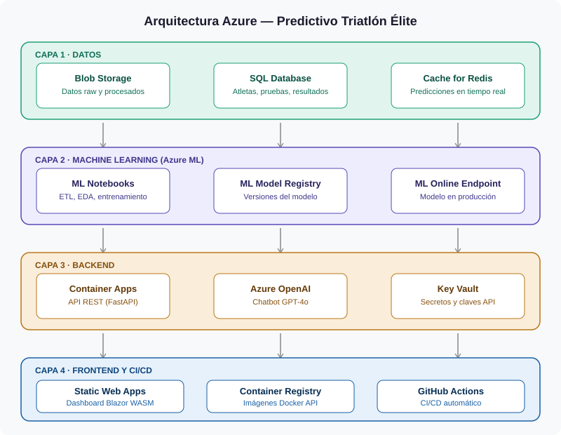
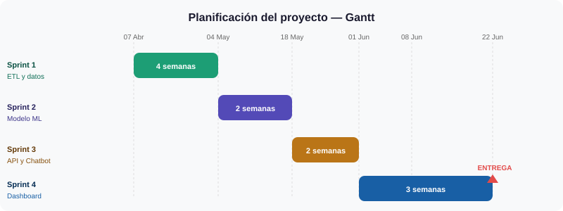
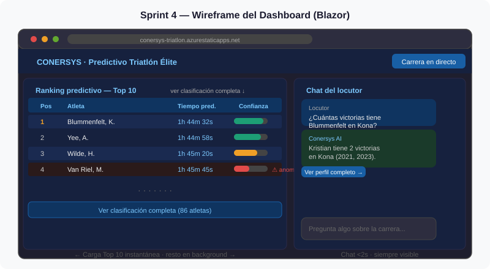

# Sprint 4 — Dashboard UI, Integración Final y Entrega

> **Fechas:** 22/06/2026 → 26/06/2026 · 3 semanas  
> **Equipo:** Mario García · Alejandro Benítez  
> **Proyecto:** Predictivo Triatlón Élite Masculino — Conersys

---

## ¿Qué hacemos en este sprint?

Construimos el dashboard en **Blazor WebAssembly**, lo conectamos a la API del Sprint 3 y preparamos la demo final. Al terminar, el locutor puede usar el sistema completo en directo.

---

## Arquitectura completa del sistema



---

## Planificación del proyecto



---

## Cómo va a verse el dashboard



**Decisiones de diseño:**

| Decisión | Razón |
|---|---|
| **Dark mode por defecto** | Los platós de TV tienen poca luz — reduce fatiga visual |
| **Tipografía grande y alto contraste** | El locutor no puede buscar datos, tiene que verlos de un vistazo |
| **Chat siempre visible** | Panel lateral fijo — nunca hay que navegar para acceder a él |
| **Top 10 instantáneo** | Carga en <2s; el resto llega en background sin que el usuario lo note |

---

## El sistema de carga en dos fases

Este es un requisito crítico para que el dashboard se sienta fluido:

```
Usuario abre el dashboard
        ↓
Query 1 (inmediata) → Carga los 10 primeros atletas del ranking → Se muestra al instante
        ↓
Query 2 (background) → Mientras el locutor lee el Top 10, descarga el resto en silencio
        ↓
Locutor pulsa "Ver más" → Los datos aparecen sin spinner
```

---

## Pantallas del dashboard

### Pantalla 1 — Ranking predictivo
- Tabla con posición, nombre, bandera, tiempo predicho e intervalo de confianza (barra visual)
- Icono de alerta para anomalías (⚠) con nivel de severidad
- Icono de advertencia para atletas con pocos datos históricos
- Botón "Ver clasificación completa" que carga el resto sin spinner

### Pantalla 2 — Perfil de atleta
- Datos básicos: nombre, país, edad, temporadas activas
- Gráfico de evolución de tiempos históricos (línea temporal interactiva)
- Predicción para la prueba actual con los 3 factores SHAP más influyentes
- Indicador de forma reciente: `↑ mejorando` / `→ estable` / `↓ empeorando`

### Pantalla 3 — Chat del locutor
- Historial de conversación de la sesión (últimas 10 preguntas)
- Indicador "escribiendo..." mientras responde el agente
- Botones de navegación contextual en cada respuesta
- Respuestas de error ("Dato no disponible") con estilo visual diferente

---

## Pruebas obligatorias antes de la demo

Estos 6 escenarios tienen que pasar sin errores:

| # | Escenario | Criterio |
|---|---|---|
| 1 | Abrir dashboard | Top 10 visible en <2s |
| 2 | Pulsar "Ver más" | Resto de atletas aparece sin spinner |
| 3 | Pregunta al chat (dato disponible) | Respuesta en <2s con botón de navegación |
| 4 | Pregunta al chat (dato inexistente) | Responde "Dato no disponible" |
| 5 | Navegar desde chat al perfil de atleta | Pantalla carga sin errores |
| 6 | Alerta de anomalía | Icono aparece en ranking, clic para ocultar funciona |

---

## Demo offline — plan B para la presentación

Para evitar problemas de conectividad en el aula, existe un **modo demo offline** que carga datos de una carrera ficticia desde un JSON local.

- Se activa con un parámetro de configuración — sin tocar el código
- Tiene los mismos datos que la versión real (pero pregrabados)
- **Siempre se presenta en modo offline primero** — la versión online es el bonus

---

## Tareas del sprint

### HU-S4.1 — Ranking predictivo con carga progresiva
Top 10 instantáneo + lazy loading del resto.

### HU-S4.2 — Panel de chat integrado
Chat visible siempre, con botones de navegación contextual en cada respuesta.

### HU-S4.3 — Perfil de atleta
Gráfico histórico interactivo + predicción con factores SHAP.

### HU-S4.4 — Alertas de anomalía
Icono visual en el ranking cuando el tiempo real se desvía del predicho.

### HU-S4.5 — Pruebas E2E
Los 6 escenarios de la tabla de arriba.

### HU-S4.6 — Demo offline y documentación
Modo offline funcional + memoria del TFM finalizada.

---

## Riesgos

| Riesgo | Impacto | Probabilidad | Plan |
|---|---|---|---|
| CORS entre Blazor WASM y la API | Alto | Media | Configurar en FastAPI desde el primer día del sprint |
| Blazor WASM lento en carga inicial | Medio | Alta | Compresión Brotli + AOT compilation en Azure Static Web Apps |
| Demo falla por conectividad en el aula | Alto | Media | **Siempre presentar en modo offline** |

---

## Resumen de decisiones técnicas del proyecto

| Decisión | Elección | Por qué |
|---|---|---|
| Variable objetivo | Tiempo final total | Solo disponemos de marca global |
| Columna "nombre carrera" | Variables numéricas (altitud, temp, desnivel, agua) | El modelo entiende números, no nombres |
| Modelo base | Random Forest o XGBoost (por RMSE) | Robusto, rápido, interpretable |
| Clasificador DSQ | Condicional a datos disponibles | Si <30 casos → Isolation Forest |
| Frontend | Blazor WebAssembly | Requisito del cliente |
| Infraestructura | 100% Azure | Requisito del cliente |
| Chatbot | Azure OpenAI GPT-4o | Latencia controlable, contexto inyectable |

---
